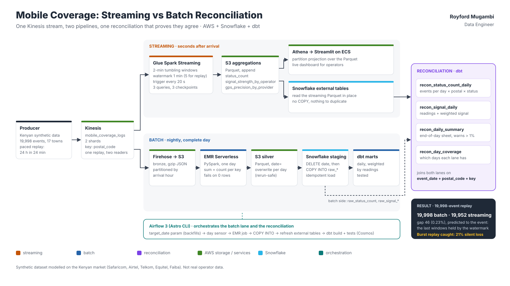

# Real-time Mobile Coverage Pipeline

The streaming lane of a two-pipeline project: mobile network readings flow from Kinesis through Glue Spark Structured Streaming into S3, where Athena feeds a live Streamlit dashboard and Snowflake reads the same files for reconciliation against a nightly batch pipeline.

The batch lane and the reconciliation live in the companion repo, [aws-streaming-batch-reconciliation](https://github.com/Roy-mugambi/aws-streaming-batch-reconciliation).

| Replay of 19,998 events | Streaming output | Gap vs batch |
|---|---|---|
| Burst, 1-minute watermark | 15,754 | 4,244 (21.2%) lost as "late" data, silently |
| Paced, 5-minute watermark | 19,952 | 46 (0.23%), the final windows held by the watermark, predicted to the event |



## Components

| Part | What it does |
|---|---|
| `producer/generator.py` | Generates a synthetic dataset modelled on the Kenyan market: 19,998 readings, 17 towns, five operators, daily peaks and congestion. Fixed seed, so every run is identical. |
| `producer/producer.py` | Sends the CSV to Kinesis (2 shards, partition key `postal_code`) with retry on partial failure. `--minutes-per-day N` replays the day in event-time order over N minutes. |
| `streaming/streaming.py` | Glue 4.0 Spark Structured Streaming: three queries (status counts, signal by operator, GPS by provider) over 2-minute tumbling windows with a watermark, writing Parquet to S3 every 20 seconds. |
| `athena/projection_tables.sql` | Athena tables with partition projection over the streaming output. |
| `dashboard/` | Streamlit on ECS Fargate (non-root container), querying Athena. |

Every aggregate carries `sum_*` and `count_*` alongside its average, so daily or per-area rollups are exactly weighted instead of averages of averages.

## What broke, and what it taught me

- **A replay lost 21% of events with no error.** Sending a full day of event time in seconds let one shard get ahead of the other; the watermark jumped with the leader and Spark dropped the other shard's records as late. Whole hours vanished per shard (shard B 00:00–07:30, shard A 08:30–16:00). The batch reconciliation caught it. Fix: paced replay plus a wider watermark for replays. [Incident write-up](https://github.com/Roy-mugambi/aws-streaming-batch-reconciliation/tree/main/docs/incidents/2026-11-07)
- **Checkpoint and sink metadata are a pair.** New checkpoints pointed at old output folders whose `_spark_metadata` already listed batches 0–7, so the sink silently skipped them and nothing was written. Reset both together, never one.
- **Postal codes are text.** Athena returned 189 of 249 rows because the projection list had lost leading zeros (`5001` instead of `05001`): the extractor had parsed codes as numbers. The Kenyan dataset keeps `00100` and `01000` on purpose to test every layer.
- **Firehose doesn't add newlines.** Records sent without a trailing `\n` arrive in S3 as `{...}{...}`, and line-based readers keep only the first object per file. The producer now newline-delimits every record.
- **The watermark explains the last events.** With no later data, the final windows stay open. The expected hold is computed from the data before every replay (16 events with a 1-minute watermark, 46 with 5 minutes) and matched exactly.

## Run a replay

Prerequisites: AWS account, Python 3.11, a Kinesis stream, the Glue job, and an S3 bucket for output and checkpoints.

```bash
python producer/generator.py                    # writes data/kenya-mobile-logs.csv (19,998 rows)

# deploy the streaming job (the repo is the source of truth, never the console editor)
aws s3 cp streaming/streaming.py s3://<glue-assets-bucket>/scripts/mobile-network-streaming.py

# start it, with the replay watermark
aws glue start-job-run --job-name mobile-network-streaming \
  --arguments '{"--WATERMARK_DURATION":"5 minutes"}'

# replay one day of event time over 24 minutes
python producer/producer.py --minutes-per-day 24
```

Stop the job once two consecutive output counts match, then delete the Kinesis stream.

**Run outside 02:30–03:30 Nairobi time** (UTC midnight): both lanes date events in UTC, and a replay that crosses midnight splits across two dates.

## Cost

About a dollar per replay: the Glue job and the dashboard are billed by the minute, and 20,000 events are about 6 MB. The Kinesis stream (2 shards, about $0.72 a day) is created for a replay and deleted the same day; the ECS task is stopped when not in use.

## Known limitations

- The dashboard reads the latest 200 rows per chart (`LIMIT 200`), so with 20,000 events it shows only the last few windows of the day. Next: daily and hourly views weighted by `sum/count`.
- Output is partitioned by hour and key but not by date, so replays from different days share folders; consumers filter on `window_start`.
- About 3,000 small Parquet files per replay. Next: scheduled compaction, or an Iceberg table.

---
Built by Royford Mugambi. Questions welcome via [LinkedIn](https://www.linkedin.com/in/<your-handle>).
